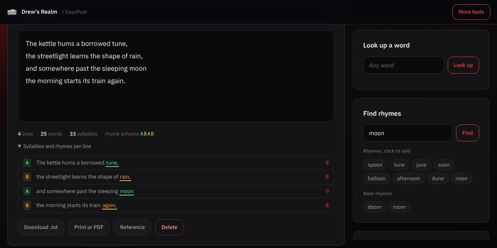

# EasePoet

A writing space for poems, with rhymes, definitions and syllable counts beside you. Live at <https://easepoet.drew-gnr.xyz/>.

## Features

- As many poems as you like, saved in the browser as you type
- Line, word and syllable counts, plus a per-line syllable breakdown
- Rhyme scheme (ABAB CDCD and so on) worked out as you type, with each rhyming pair of line endings in its own colour. It goes by spelling, so treat it as a guide
- Syllables come from a built-in estimator that works offline. Tick "Ask Datamuse for exact counts" to have Datamuse count them instead; it is off until you switch it on, because it sends each word of your poems to datamuse.com. Results are cached so each word is only looked up once
- Rhymes and near rhymes. Click one to put it in your poem where the cursor was
- Dictionary look-up with meanings and examples
- Reference image, audio or video for each poem, stored in the browser (IndexedDB, 50 MB each)
- Download a poem as `.txt`, download them all, or print or save as PDF
- Deleting asks first
- Keyboard: <kbd>Alt</kbd>+<kbd>N</kbd> new poem, <kbd>Alt</kbd>+<kbd>L</kbd> look up, <kbd>Alt</kbd>+<kbd>R</kbd> rhymes, <kbd>Ctrl</kbd>+<kbd>S</kbd> download
- Poems from the old version are moved over automatically the first time you open it

## Services

- Rhymes and syllables: <https://www.datamuse.com/api/>
- Definitions: <https://dictionaryapi.dev/>

Neither needs a key. Looking up a word or finding rhymes sends only that word. Your poems stay in the browser unless you switch on exact syllable counts, which sends each word of your poems to Datamuse.

## Files

| Path | What it is |
| --- | --- |
| `index.html` | The page |
| `assets/syllables.js` | Syllable estimator and line stats, also loadable in Node |
| `assets/rhymes.js` | Rhyme matching and rhyme scheme, also loadable in Node |
| `assets/app.js` | Poems, tools, storage and shortcuts |
| `assets/app.css` | Layout for this tool |
| `assets/theme.css`, `assets/ui.js` | Shared drew-gnr.xyz look and helpers |
| `assets/fonts/` | IBM Plex, self-hosted (SIL OFL, see `OFL.txt`) |
| `tests/syllables.test.js` | `node tests/syllables.test.js` |
| `tests/rhymes.test.js` | `node tests/rhymes.test.js` |

## Hosting

Static files only. `CNAME` is set for GitHub Pages.
